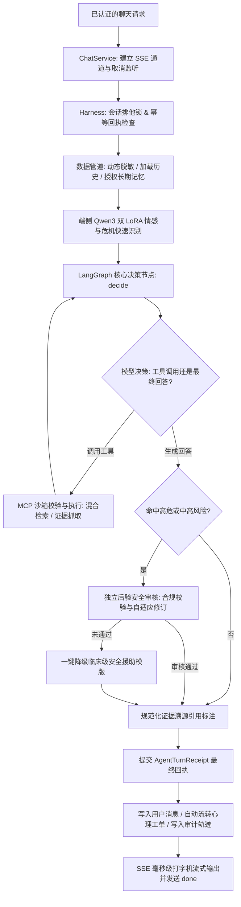

# 心栖 · SolaceAI

<div align="center">

**基于智能体编排与混合检索增强（RAG）的工业级端云协同心理健康支持系统**  
*An Industrial-Grade Edge-Cloud Collaborative Mental Health Agent Powered by LangGraph, Multi-Stage Hybrid RAG, and MLX Dual-LoRA*

[](https://www.python.org/)
[](https://fastapi.tiangolo.com/)
[](https://github.com/langchain-ai/langgraph)
[](https://www.llamaindex.ai/)
[](https://modelcontextprotocol.io/)
[](docs/guide.md#第三章端侧-qwen3-4b-共享基座双-lora-微调与-metal-加速体系)
[](docs/guide.md#第三章端侧-qwen3-4b-共享基座双-lora-微调与-metal-加速体系)
[](tests/)
[](deploy/)

[🚀 在线演示](https://mindbridge.wenyuecheng.cn) · [📖 系统架构指南 (核心白皮书)](docs/guide.md) · [📊 性能基准报告](docs/evaluation.md) · [⚡ 极速上手](#-极速上手与部署-quick-start) · [📂 官方文档中心](docs/README.md)

</div>

---

## 🌟 旗舰级量化性能看板 (Flagship Performance Metrics)

在 123 组覆盖高校复杂真实咨询场景的标准化测试集（Benchmark）以及 2400 条垂直领域精标数据集上，SolaceAI 展现出卓越的算法精度与工业级可靠性：

| 维度 | 评测指标 | 达成表现 | 架构与算法保障 |
| :--- | :--- | :---: | :--- |
| **检索召回率** | **Hit@4** | **100.00%** | 父子分块 + BGE-M3 (稠密向量 + 学习型稀疏) 双路召回 |
| **检索排序质量** | **MRR@4** | **0.9959** | 互惠名次融合 (RRF) + Cross-Encoder 交叉编码器精排 |
| **检索前向准度** | **Precision@4** | **90.85%** | LlamaIndex 编排 + 三层文档抗噪解析治理 |
| **端侧微调精度** | **Accuracy (4分类)** | **99.75%** | Qwen3-4B MLX 4-bit 双 LoRA 架构（分类 LoRA 准确率 99.75%） |
| **分类综合质量** | **Macro F1-Score** | **0.9975** | 高风险零漏判，真实交替推理与云端故障降级全量通过 |
| **端侧回答对齐** | **4D 综合质量均分** | **3.253 / 5.0** | PERM-GRPO 64 步强化学习（四模型统一盲测最高分，全面超越基座） |
| **盲测对决胜率** | **Head-to-Head Preference** | **56.25%** | 80 题对决对原始基座 27 胜 36 平 17 负，换序复评一致性 93.75% |
| **系统工程健壮性** | **自动化回归测试** | **590+ Passed** | 592 项全量测试持续通过，覆盖端到端状态机、异步投递与危机熔断 |

---

## 💡 核心架构与技术创新 (Key Technical Highlights)

```mermaid
graph TD
    Client[客户端: Web / 移动端 / 微信生态] -->|SSE 流式交互| API[FastAPI 网关服务]
    
    subgraph ControlPlane["【控制平面】Harness 运行时层"]
        API --> Lock[并发会话文件锁 & 防重幂等]
        Lock --> Mask[敏感隐私实体动态脱敏管道]
        Mask --> DSH[自适应 DSH 上下文压缩调度器]
    end

    subgraph ReasoningPlane["【推理平面】端云协同异构编排引擎"]
        DSH --> EdgeClass[端侧 Qwen3-4B 双 LoRA 引擎<br/>毫秒级私密情感分类 & 危机拦截]
        EdgeClass --> Router{意图分流与状态机驱动}
        
        Router -->|CHAT / 闲聊安抚| CloudLLM[云端深度认知大模型: DeepSeek<br/>(云端异常时自动降级至端侧 Qwen3 回答 LoRA)]
        Router -->|CONSULT / 循证咨询| RAGEngine[多阶段高精度混合检索 RAG]
        Router -->|RISK / 明确高危| SafetyGate[确定性危机干预 & 安全模板熔断]
        
        RAGEngine --> LangGraph[LangGraph 有界 Agent 工具循环]
        LangGraph --> MCP[Model Context Protocol 工具标准沙箱]
        MCP --> CloudLLM
        CloudLLM --> Review[独立后验安全审核节点]
    end

    subgraph DataPlane["【数据与知识存储平面】"]
        RAGEngine --> Milvus[(Milvus 向量库: BGE-M3)]
        RAGEngine --> BM25[(BM25 稀疏词法索引)]
        LangGraph --> MySQL[(MySQL 业务库 / SQLite)]
        LangGraph --> Redis[(Redis 会话缓存与分布式锁)]
        SafetyGate --> AdminAlert[管理员实时危机个案工单 & Excel 台账导出]
    end
```

### 1. Monorepo 微内核解耦架构 (Microkernel Monorepo)
- **微内核物理隔离**：系统沉淀核心业务微内核包 `packages/core/app`，将状态机编排、多阶段检索算法、危机评估与通用实体集中维护，彻底解耦具体部署运行环境。
- **多端适配器矩阵**：
  - `apps/offline`：线下生产完整适配器，搭载 MySQL、Milvus 分布式向量库与 BGE-M3 深度重排，支撑校级高并发私有化交付；
  - `apps/online`：线上轻量适配器，搭载 SQLite、Chroma 向量存储与 BM25 词法引擎，提供低内存开箱即用体验；
  - `apps/rag_worker`：独立检索计算工作进程，实现重型模型计算与业务 Web 容器的物理进程隔离。
- **静态 AST 架构边界检测**：配备 [`scripts/check-boundaries.py`](scripts/check-boundaries.py)，通过 Python 抽象语法树分析强制执行单向依赖约束，彻底杜绝下层反向污染。

### 2. 企业级“端云协同”异构计算与 PERM-GRPO 容灾降级体系

系统创新性引入结合前沿论文 **PERM（Findings of ACL 2026）** 与 **GDPO（2026）** 解耦归一化思想的 **PERM-GRPO 原生强化学习体系**，针对单卡消费级算力完成了 64 步端到端对齐，打造工业级端侧高可用回答降级引擎：

- **端侧极速感知与故障降级**：采用 **Qwen3-4B-Instruct** 共享基座与独立双 LoRA 适配器（MLX 4-bit / Metal 原生硬件加速）。
  - **分类 LoRA (`solace-emotion`)**：以毫秒级延迟完成私密情感识别与危机分级（400条测试集准确率 **99.75%**、Macro F1 **0.9975**、高风险零漏判）；
  - **回答 LoRA (`solace-response`)**：搭载 **PERM-GRPO 第 64 步终态快照**（`solace-response-perm-grpo64`）。在 80 题四模型统一盲测中，四维综合质量均分达到 **3.253**（情绪理解 3.400 / 共情表达 3.263 / 需求满足 3.200 / 整体质感 3.150），全面超越原始基座（3.169）与基础 GRPO（3.212）；在两两盲测对决中对原始基座取得 **56.25%** 偏好得分率（27 胜 36 平 17 负），换序复测一致性达 **93.75%**。在倾听与支持核心 40 题场景中展现出细腻温情的同理心与扎实交付力。
- **云端深度推理与自适应熔断**：云端接入大模型（DeepSeek）进行多轮深度共情表达与认知重构；当云端 API 出现超时、5xx 或网络抖动时，系统自动无缝降级至端侧 Qwen3 回答 LoRA，实现“端侧低延迟私密感知 + 云端高智能拟人共情 + 零云依赖离线服务韧性”的完整闭环。
- **独立守护进程看门狗架构**：训练与运行时配备独立 supervisor watchdog（`gdpo_watchdog.py`），支持超时租约硬管控与自愈式单次 OOM 降级重启，以超低绿色算力成本（~6.45 元）实现高稳定对齐。

### 3. 多阶段混合检索（RAG）与三层文档抗噪防线
- **端到端多阶段流水线**：
  - **文档切分**：基于 Docling 统一结构化解析，采用“父段落 1200 字符 + 子块 300 字符 + 重叠 40 字符”的层级分块，子块用于精准定位，父块用于提供饱满上下文。
  - **双路召回**：**BGE-M3**（1024 维稠密语义向量）与学习型稀疏词表（Sparse/BM25）协同召回 Top-20 候选。
  - **排序融合**：引入 **RRF（Reciprocal Rank Fusion，互惠名次融合）** 算法，无缝消除稠密分数与稀疏分数的量纲差异。
  - **深度重排**：采用 **Cross-Encoder（`bge-reranker-large`）** 进行全交叉自注意力打分，精选最终 Top-4 黄金证据注入模型上下文。
- **工业级“三层防线”文档治理**：
  针对非规范 PDF/扫描件与老旧文档，设计**“入口字符度量预检（过滤无效乱码，$Ratio \ge 80\%$） ➔ 结构化语义段落重组 ➔ 高维向量空间自然抗噪（残余噪声 Cosine 极低自然沉底）”**，彻底攻克数据入库污染难题。

### 4. 自适应 DSH 上下文自适应压缩机制 (Dynamic Slicing & Harnessing)
- 针对多轮长程会话，创新落地自适应窗口管理策略（默认窗口 $W=8192$，动态触发阈值 3584 tokens，近期原文保留目标 655 tokens）。
- **三阶平滑压缩管道**：
  1. *第一阶段*：对单次超大工具观察结果进行投影智能裁剪（保留关键首尾与元数据）。
  2. *第二阶段*：触发滚动摘要生成器，对早期轮次进行结构化状态折叠，严格保留近期高频原文窗口。
  3. *第三阶段*：动态证据投影裁剪，确保当前核心问题与高危干预规则获得绝对最高的 Token 预算保障。

### 5. 白盒化 ReAct 可解释性执行轨迹流 (Observable Trace)
- **六阶段执行状态机**：严格划分为 `Prepare`（脱敏与安全预检）➔ `Reason`（决策摘要）➔ `Act`（工具调用）➔ `Observe`（观察回执）➔ `Answer`（候选生成）➔ `Review / Deliver`（安全审核与分发）。
- **毫秒级 SSE 流式可视化**：实时打字机事件流与阶段元数据无缝推送，赋予系统极致感知体验与完全白盒化的学术解释性。

### 6. 高可用身份安全与基于分布式租约锁的邮件投递协议
- **安全认证闭环**：学生邮箱验证码登录、Argon2id 强哈希算法、HttpOnly/Secure 会话 Cookie 彻底防御 XSS 攻击。
- **分布式租约锁投递自愈**：针对异步 SMTP 投递与本地数据库提交无法跨系统 2PC 的痛点，自研基于原子租约锁（Lease Lock）的幂等自愈协议，彻底杜绝并发重投与告警风暴。

### 7. 临床级双重危机干预闭环 (Human-in-the-Loop)
- **前置规则秒级熔断**：前置确定性危险模式匹配引擎，一旦捕获极端自伤风险信号，瞬间跳过模型直接判定最高风险级别（HIGH），并强制加载危机干预技能。
- **后验独立安全审核节点**：生成端配备独立安全审核守卫（Safety Reviewer），对高风险候选回复进行合规审查，必要时触发单次自适应修订；若二次审核未通过，直接降级至临床标准危机求助安全模版。
- **多角色协同与台账追溯**：自动创建风险追踪工单，联动管理员后台实时预警，并支持一键导出符合防 CSV/Excel 注入规范的中文跟进台账。

---

## 🔄 端到端单轮执行链路 (Execution Pipeline)



---

## ⚡ 极速上手与部署 (Quick Start)

### 方式一：Docker 容器编排极速部署（推荐）

```bash
# 1. 克隆代码仓库
git clone https://github.com/wenyuecheng/solaceai.git
cd solaceai

# 2. 启动生产级全功能容器栈 (API + MySQL + Redis)
docker compose --env-file .env -f apps/offline/compose.yml up -d --build

# 或启动面向低内存环境的轻量化容器栈 (Chroma + SQLite)
docker compose -f apps/online/compose.yml up -d --build
```

### 方式二：本地虚拟环境部署

```bash
# 1. 创建并激活 Python 3.11+ 虚拟环境
python3 -m venv .venv
source .venv/bin/activate

# 2. 安装核心包与适配器直接依赖
pip install -r apps/online/requirements.lock
pip install --no-deps -e packages/core -e apps/online

# 3. 运行全量自动化测试保障系统完整性 (500+ 项测试)
pytest tests/ -q

# 4. 启动后端 API 服务
uvicorn apps.online.main:app --host 0.0.0.0 --port 8080 --reload
```

---

## 📂 工程架构与目录矩阵

```
solaceai/
├── packages/core/app/                # 系统核心微内核命名空间 (共享业务与算法实现)
│   ├── agents/                       # LangGraph 状态机、GraphRuntime 与 Harness 编排
│   ├── services/                     # 核心服务: 混合检索、上下文压缩(DSH)、文档治理、危机评估
│   ├── api/                          # FastAPI 路由、SSE 流式端点与管理员管控接口
│   ├── knowledge/                    # 知识库 39 篇权威主题文献与来源清单
│   └── models/                       # 数据库 ORM 实体与 Pydantic 校验模型
├── apps/                             # 独立应用适配器与独立 Worker
│   ├── online/                       # 线上轻量适配器 (SQLite + Chroma + Redis)
│   ├── offline/                      # 线下生产适配器 (MySQL + Milvus + Redis)
│   └── rag_worker/                   # 独立 BGE-M3 / Cross-Encoder 模型计算服务
├── experiments/qwen3_bonus/           # Qwen3-4B 双 LoRA 训练代码与实验产物
├── docs/                             # 系统权威技术文档矩阵
│   ├── README.md                     # 文档中心全局导航
│   ├── guide.md                      # 🔥 核心白皮书: 系统架构、微内核设计与全栈工程落地权威指南
│   └── evaluation.md                 # 权威性能基准评测报告 (100% Hit@4, RAGAS 深度分析)
├── evaluation/                       # 离线自动化评测套件与标注真值数据集
│   ├── suites/                       # 自动化 Benchmark 执行套件与双裁判交叉评分
│   └── data/                         # 123 题核心基准用例与权威评测样本
├── frontend/                         # 现代化 Vue 3 + TailwindCSS 前端交互界面
├── deploy/                           # Docker Compose 编排、环境预设与模块化依赖
└── tests/                            # 自动化测试套件 (500+ 测试全覆盖)
```

---

## 📜 理论基石与参考文献 (Scientific Foundations & Citations)

SolaceAI 系统架构与核心算法严格遵循并拓展了人工智能、自然语言处理与信息检索领域的经典理论：

```bibtex
@inproceedings{cheng2026perm,
  title={PERM: Psychology-grounded Empathetic Reward Modeling for Large Language Models},
  author={Cheng, Yu and others},
  booktitle={Findings of the Association for Computational Linguistics: ACL 2026},
  year={2026}
}

@article{zhang2026gdpo,
  title={GDPO: Group reward-Decoupled Normalization Policy Optimization for Multi-reward RL Optimization},
  author={Zhang, Zhaowei and others},
  journal={arXiv preprint arXiv:2601.05242},
  year={2026}
}

@inproceedings{lewis2020retrieval,
  title={Retrieval-augmented generation for knowledge-intensive nlp tasks},
  author={Lewis, Patrick and Perez, Ethan and Piktus, Aleksandra and Petroni, Fabio and others},
  booktitle={Advances in Neural Information Processing Systems (NeurIPS)},
  volume={33},
  pages={9459--9474},
  year={2020}
}

@inproceedings{dettmers2023qlora,
  title={Qlora: Efficient finetuning of quantized llms},
  author={Dettmers, Tim and Pagnoni, Artidoro and Holtzman, Ari and Zettlemoyer, Luke},
  booktitle={Advances in Neural Information Processing Systems (NeurIPS)},
  volume={36},
  year={2023}
}

@inproceedings{cormack2009reciprocal,
  title={Reciprocal rank fusion outperforms condorcet and individual rank learning methods},
  author={Cormack, Gordon V and Clarke, Charles LA and B{\"u}ttcher, Stefan},
  booktitle={Proceedings of the 32nd International ACM SIGIR Conference (SIGIR)},
  pages={758--759},
  year={2009}
}

@inproceedings{yao2022react,
  title={ReAct: Synergizing Reasoning and Acting in Language Models},
  author={Yao, Shunyu and Zhao, Jeffrey and Yu, Dian and others},
  booktitle={International Conference on Learning Representations (ICLR)},
  year={2023}
}
```

---

## 📄 开源许可与合规致谢

本项目采用 [MIT License](LICENSE) 开源许可。系统仅提供情绪舒缓支持与心理知识科普检索，不替代任何线下面对面的临床医疗诊断与专业精神卫生干预。系统内置临床急救援助热线与快速人工个案转介通道。
