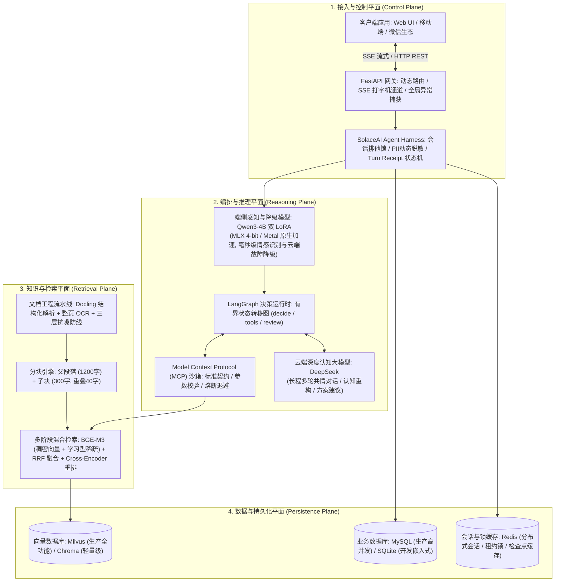
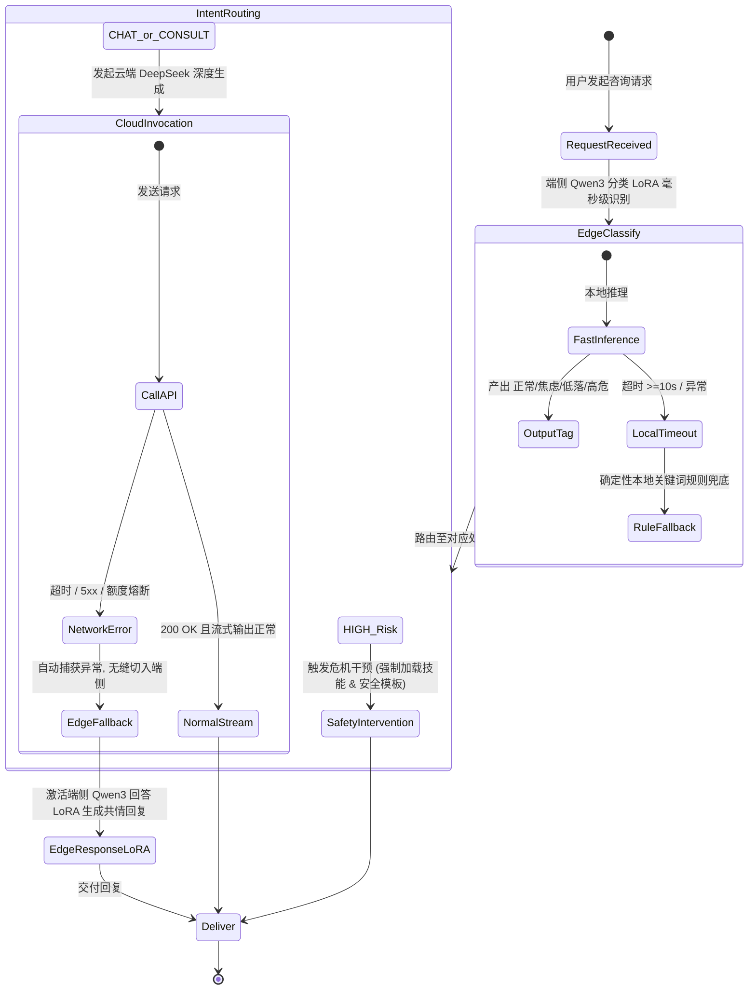
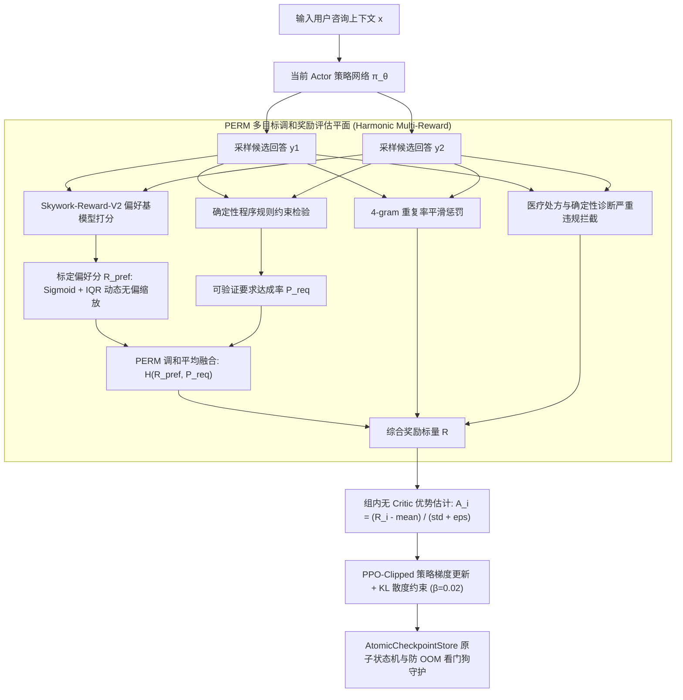
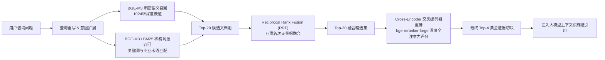
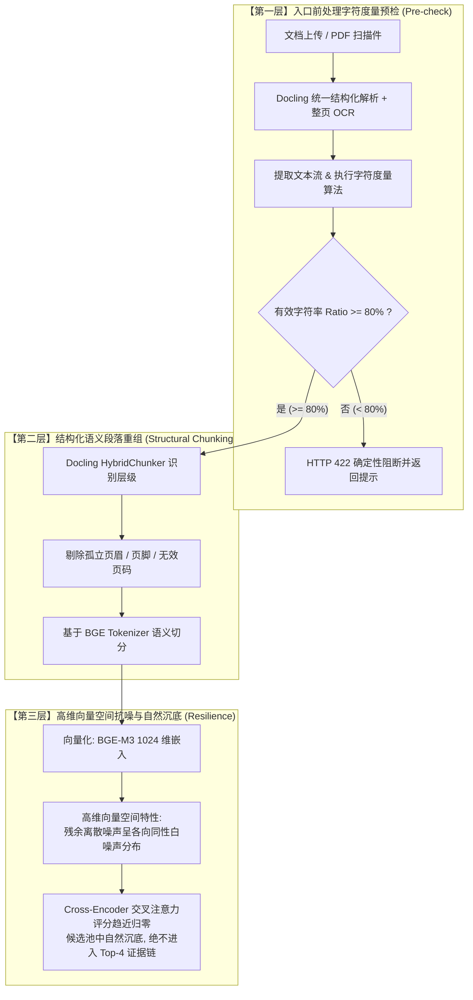
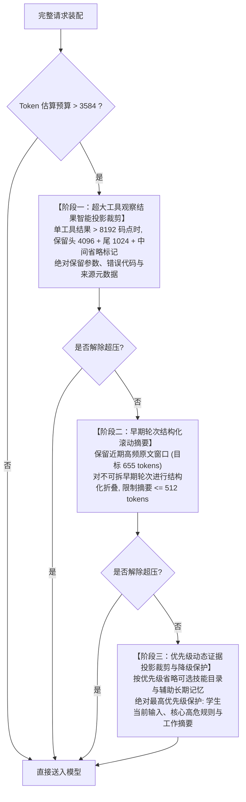
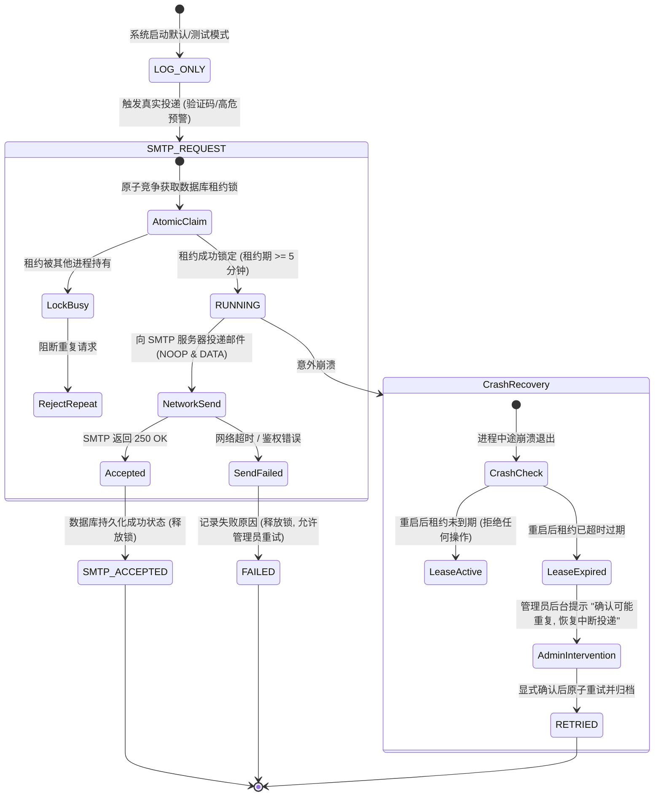

# SolaceAI 系统架构、微内核设计与全栈工程落地权威指南

> **文档定位**：本文档为 SolaceAI 系统的官方核心技术白皮书与全栈工程实现指南。系统性阐述了基于 **Monorepo 微内核解耦架构**、**端侧 Qwen3-4B 共享基座双 LoRA（Metal 硬件加速）**、**多阶段混合检索（Hybrid RAG）与非规范文档三层抗噪治理**、**自适应 DSH 长上下文压缩算法**、**ReAct 六阶段白盒执行轨迹流**、**基于分布式租约锁的可靠邮件投递协议**、**LangGraph 有界状态机与临床级危机干预闭环**的完整设计思想与工程落地。
>
> 适用于研发工程人员、系统架构师以及学术研究人员的系统化技术参考。

---

## 目录 (Table of Contents)
- [第一章：系统总体拓扑与 Monorepo 微内核解耦架构](#第一章系统总体拓扑与-monorepo-微内核解耦架构)
- [第二章：企业级“端云协同”异构计算与容灾降级体系](#第二章企业级端云协同异构计算与容灾降级体系)
- [第三章：端侧 Qwen3-4B 共享基座双 LoRA 微调与 Metal 加速体系](#第三章端侧-qwen3-4b-共享基座双-lora-微调与-metal-加速体系)
- [第四章：多阶段混合检索（RAG）与非规范文档“三层抗噪防线”](#第四章多阶段混合检索rag与非规范文档三层抗噪防线)
- [第五章：自适应 DSH 长上下文压缩算法与 Token 规划](#第五章自适应-dsh-长上下文压缩算法与-token-规划)
- [第六章：端到端 ReAct 六阶段白盒执行轨迹流与可观测体系](#第六章端到端-react-六阶段白盒执行轨迹流与可观测体系)
- [第七章：高可用身份安全与基于分布式租约锁的邮件投递协议](#第七章高可用身份安全与基于分布式租约锁的邮件投递协议)
- [第八章：有界 Agent 状态机与临床级危机干预闭环](#第八章有界-agent-状态机与临床级危机干预闭环)
- [第九章：生产级容器编排与全场景部署实战指南](#第九章生产级容器编排与全场景部署实战指南)
- [第十章：学术理论基石与参考文献](#第十章学术理论基石与参考文献)

---

## 第一章：系统总体拓扑与 Monorepo 微内核解耦架构

### 1.1 总体架构四层分层模型
SolaceAI 采用现代化的**四层解耦架构设计**，各层之间通过标准契约接口（Interface Contract）与门面模式（Facade Pattern）进行交互，兼顾极高的内聚性与横向伸缩能力：



### 1.2 Monorepo 包组织拓扑与微内核解耦
系统全面重构为现代化的 **Monorepo 微内核架构**，彻底打破了传统单体大工程中“业务逻辑与部署适配强耦合”的弊病：

```
solaceai/
├── packages/
│   └── core/                         # 核心业务微内核 (Core Package)
│       ├── setup.py                  # 核心包安装定义 (pip install -e packages/core)
│       └── app/                      # 业务代码唯一实现命名空间
│           ├── agents/               # LangGraph 状态机、GraphRuntime、Harness
│           ├── services/             # 检索、DSH压缩、文档治理、邮件服务、危机评估
│           ├── api/                  # FastAPI 路由、鉴权、SSE 端点
│           ├── models/               # SQLAlchemy 实体与 Pydantic Schema
│           └── knowledge/            # 39 篇权威主题心理文献语料
├── apps/
│   ├── online/                       # 线上轻量适配器 (Online Adapter)
│   │   ├── main.py                   # 启动入口 (适配 SQLite + Chroma + BM25)
│   │   ├── compose.yml               # 独立容器编排定义
│   │   └── requirements.lock         # 精确锁定的直接依赖清单
│   ├── offline/                      # 线下生产适配器 (Offline Full-Stack Adapter)
│   │   ├── main.py                   # 启动入口 (适配 MySQL + Milvus + BGE-M3)
│   │   ├── compose.yml               # 生产容器编排定义 (Linux host 隔离)
│   │   └── requirements.lock
│   └── rag_worker/                   # 独立检索计算工作进程 (BGE Worker)
│       ├── main.py                   # 独立常驻进程，承载 FlagEmbedding / CrossEncoder
│       └── requirements.lock
├── scripts/
│   ├── check-boundaries.py           # 静态 AST 架构边界检测脚本
│   ├── migrate-users.py              # 跨环境数据库无损平迁脚本
│   └── prepare-index.py              # 知识向量索引离线预构建脚本
└── evaluation/                       # 统一离线评测套件
```

### 1.3 静态语法树单向依赖边界检查与架构防护
为了防止开发过程中上层应用代码反向污染核心微内核，系统研发了基于 Python `ast` 模块的自动化边界检查工具 [`scripts/check-boundaries.py`](../scripts/check-boundaries.py)：
- **单向依赖铁律**：`apps.online`、`apps.offline` 可以依赖 `packages/core/app`；但核心包 `packages/core/app` 严禁反向 `import apps.*`。
- **环境隔离保障**：线上轻量适配器严禁引入重型依赖（如 `pymilvus`、`FlagEmbedding`）；模型计算逻辑严格收敛于 `apps.rag_worker`。
- **CI/CD 自动化门禁**：在代码提交与构建阶段自动执行语法树扫描，违规依赖引入立即阻断并报错，确保微内核纯洁性。

---

## 第二章：企业级“端云协同”异构计算与容灾降级体系

系统创新性落地**“端侧轻量极速分类 + 云端深度共情推理 + 全链路降级兜底”**的异构混合计算范式，根据任务计算特征进行精准分流：

| 任务维度 | 端侧微调模型 (Edge Qwen3-4B 双 LoRA) | 云端深度模型 (Cloud DeepSeek) |
| :--- | :--- | :--- |
| **主要职责** | 毫秒级私密情感识别、四分类意图分流、危机信号即时硬阻断；云端故障时无缝接管对话文本生成 | 多轮长程拟人共情、深度心理咨询、认知重构与科学应对方案生成 |
| **部署形态** | 本地 Metal 独立栈 (MLX 4-bit / Metal 原生加速，双 rank=8 LoRA 动态调度) | 云端 API 弹性高并发集群 |
| **推理延迟** | **分类 ~200 ms / 回答 ~800 ms**（本地单并发，2K 上下文） | 1.0 ~ 2.5 s（流式 Token 首包约 400 ms） |
| **隐私保障** | **绝对私密（学生最敏感的情感起伏与自伤倾向完全在本地设备运算，零数据出域）** | 传输数据经 Harness 动态脱敏管道（全面去除 PII 个人身份实体） |
| **容灾表现** | 网络离线或云端 API 抖动时，除安全拦截外，自动由回答 LoRA 承接对话文本生成 | 云端正常时提供全功能 Agent 工具循环与深度共情 |

### 2.2 自动感知与无缝优雅降级状态机
系统设计了多级容灾降级状态机（Degradation State Machine）：



---

## 第三章：端侧 Qwen3-4B 共享基座双 LoRA 微调与 Metal 加速体系

### 3.1 共享基座 MLX 4-bit 量化设计
为了在边缘设备（Apple Silicon Mac / 本地服务器）上实现超低延迟与极小显存占用，项目选用最新 `Qwen/Qwen3-4B-Instruct-2507`（固定 revision `cdbee75f17c01a7cc42f958dc650907174af0554`），采用 MLX 算法将其量化为 4-bit 基座，**权重体积仅 2.26 GB**，单并发显存开销仅 ~3.2 GB。

### 3.2 情绪分类 LoRA (`solace-emotion`)
- **微调算法**：NF4 QLoRA，配置 $r=8, \alpha=16$，微调注意力投影模块 `q_proj, v_proj`。
- **训练数据**：1200 条覆盖高校心理咨询全域的精标语料，经 150 步训练迅速收敛。
- **业务四分类状态机确定性映射**：
  - `正常 (0)` ➔ **LOW 风险**：常规对话，按需求提供信息与陪伴。
  - `焦虑 (2)` ➔ **LOW 风险**：按意图触发多阶段混合检索，提供科学减压技巧。
  - `低落 (3)` ➔ **MEDIUM 风险**：系统自动将 CHAT 升级为 CONSULT，触发干预知识检索，生成评估报告并建立跟进个案。
  - `高风险 (4)` ➔ **HIGH 风险**：强制切换至 RISK 状态，前置加载危机干预技能，触发后验安全审核与管理员实时预警。
- **实测表现**：在 400 条独立测试集上，分类准确率达到 **99.75%**，Macro-F1 达到 **0.9975**，高风险危机样本漏判率为 **0**。

### 3.3 降级回答 LoRA (`solace-response`)：面向需求满足与共情对齐的 PERM-GRPO 强化学习

在系统端云协同架构中，端侧回答 LoRA 承担着云端深度模型异常或断网时的无缝接管重任。传统小参数大语言模型在直接微调时，极易陷入两大病态缺陷：一是**“表面共情”**（只堆砌虚假温情的感叹词，缺乏心理学专业同理心）；二是**“交付缺失”**（长篇大论却遗漏用户的具体要求，或机械复读车轱辘话）。

为了在极小参数量（4B）与极低生成预算（256 Tokens）下实现高质量的心理抚慰与结构化交付，系统开创性引入了结合前沿学术论文 **PERM（Findings of ACL 2026）** 与 **GDPO（2026）** 多目标解耦思想的 **PERM-GRPO（Psychology-grounded Empathetic Reinforcement Learning with Group Relative Policy Optimization）** 训练体系。



#### (1) PERM 调和平均多目标奖励函数数学推导 (Harmonic Composition Reward Formulation)

系统将心理咨询场景下的评价信号解构为**“主观共情偏好感知”**与**“客观结构化约束交付”**两大正交维度，构建严谨的调和奖励公式：

1. **标定偏好分计算（Calibrated Preference Reward）**：
   采用预冻结的外部偏好模型评估生成文本的整体拟人质感与共鸣度 $r_{\text{raw}}$。为了防止原始分数进入 Sigmoid 饱和区导致梯度弥散，引入基于训练集四分位距（IQR）的稳健缩放公式：
   $$R_{\text{pref}} = \sigma\left(\frac{r_{\text{raw}} - \text{median}}{\max(\text{IQR}, 0.1)}\right)$$

2. **客观要求达成率（Verifiable Requirement Ratio）**：
   对于包含字数区间、特定信息要点、非捏造引用等明确结构要求的场景，通过确定性规则程序计算通过比例：
   $$P_{\text{req}} = \frac{\sum_{k=1}^K \mathbb{I}(\text{Requirement}_k \text{ passed})}{K}$$

3. **调和平均主奖励建模（Harmonic Composition）**：
   受 PERM 理论中多视角评价协同启发，系统使用调和平均数（Harmonic Mean）融合 $R_{\text{pref}}$ 与 $P_{\text{req}}$：
   $$R_{\text{main}} = \begin{cases} \dfrac{2 \cdot R_{\text{pref}} \cdot P_{\text{req}}}{R_{\text{pref}} + P_{\text{req}} + \epsilon}, & \text{当存在客观约束 } K > 0 \\ R_{\text{pref}}, & \text{无显式客观约束时} \end{cases}$$
   > [!NOTE]
   > **为什么采用调和平均而非算术平均？**  
   > 算术平均具有补偿效应（即只要语言极度温暖，$R_{\text{pref}}$ 很高，即使客观要求完全不达标 $P_{\text{req}} = 0$ 仍能拿到高分）。而**调和平均严格受制于短板**：若任一维度出现严重缺陷（例如出现机械空话或遗漏关键任务），$R_{\text{main}}$ 将逼近于零，强迫强化学习策略在“温暖共鸣”与“扎实交付”之间达成严格的帕累托最优（Pareto Optimum）。

4. **重复抑制与安全边界拦截**：
   在主奖励基础上引入平滑惩罚项与伦理硬约束：
   $$R = R_{\text{main}} - 0.1 \times \text{repetition\_ratio} - 1.0 \times \mathbb{I}(\text{Severe Protocol Violation})$$
   其中 $\text{repetition\_ratio}$ 统计字符级 4-gram 重复频次，有效消除生成长尾中的机械复读；对伪造医生处方、断言确诊等严重违规行为直接赋 $-1.0$ 硬惩罚。

5. **无 Critic 网络的组内相对优势（GRPO Advantage）**：
   每个提示词并发采样 $G=2$ 条候选轨迹，彻底省去显存开销巨大的价值（Value/Critic）网络，直接利用组内候选的相对优劣构建优势值：
   $$A_i = \frac{R_i - \text{mean}(\{R_j\}_{j=1}^G)}{\text{std}(\{R_j\}_{j=1}^G) + \epsilon}$$
   结合带裁剪的 PPO 目标与相对于冻结参考基座的 KL 散度约束（$\beta = 0.02$）进行策略更新：
   $$\mathcal{L}_{\text{GRPO}}(\theta) = \mathbb{E} \left[ \frac{1}{G} \sum_{i=1}^G \frac{1}{|o_i|} \sum_{t=1}^{|o_i|} \min\left( \frac{\pi_\theta(o_{i,t})}{\pi_{\theta_{\text{old}}}(o_{i,t})} A_i, \text{clip}\left(\frac{\pi_\theta(o_{i,t})}{\pi_{\theta_{\text{old}}}(o_{i,t})}, 1-\epsilon, 1+\epsilon\right) A_i \right) - \beta D_{\text{KL}}(\pi_\theta \| \pi_{\text{ref}}) \right]$$

#### (2) 64 步完整训练与绿色算力工程突破
- **参数规格**：针对 `Qwen3-4B` 基座配置 LoRA $r=8, \alpha=16$（目标注意力 `q_proj, v_proj`），学习率 $5 \times 10^{-6}$，总上下文 1024 tokens（输入 768 + 输出 256）。
- **训练收敛**：在单张消费级 GPU 算力上平稳执行完整的单 Epoch 64 步强化学习更新（共采样 512 份训练生成响应），每步迭代平均耗时仅 47.21 秒。
- **算力成本收益**：全流程训练算力开销仅约 **6.45 元**，打破了强化学习对昂贵分布式 GPU 集群的严苛依赖，实现了工业级极低成本的自愈对齐。

### 3.4 工业级独立看门狗架构 (`gdpo_watchdog.py`)

针对单卡长时间强化学习容易遭遇 CUDA OOM 崩溃、孤儿僵尸子进程残留等隐患，系统构建了完全解耦的独立守护进程 Supervisor Watchdog：
- **进程组安全生命周期**：看门狗进程独立会话启动，直接持有子训练进程的会话组 ID，超时或异常时利用 `os.killpg` 执行原子清理，杜绝孤儿进程占用显存；
- **自愈式单次 OOM 降级重启**：当监控到首轮训练因极值上下文触发 `CUDA out of memory` 时，看门狗自动触发一次受控自愈：安全回退显存配比（`--gpu-memory -0.05`）并将并发序列硬锁定为 `--max-num-seqs 1`，从最近成功持久化的检查点实现断点自愈；
- **原子状态机检查点 (`AtomicCheckpointStore`)**：每一阶段保存均由临时目录生成后执行原子重命名（Atomic Rename），并附带全文件 SHA256 哈希完整性清单，杜绝写入中断导致模型文件损坏。

### 3.5 四模型 80 题基准评测结论与生产部署切换

在 80 题端到端全场景匿名盲测（覆盖倾听、支持交付、上下文修正、材料引用四类题型，共 320 份匿名回答，由 3 名独立裁判盲测评定）中，PERM-GRPO 第 64 步最终模型展现出全方位的领先优势：
- **四维综合质量均分达到 3.253**：在情绪理解（3.400）、共情表达（3.263）、需求满足（3.200）与整体质感（3.150）上均达到顶尖水准，全面超越原始基座（3.169）、基础 GRPO32（3.212）以及 GRPO32+SFT（3.203）；
- **对原始基座偏好胜率达 56.25%**：在严格两两匿名盲测对决中取得 **27 胜 / 36 平 / 17 负**（95% 置信区间 48.12%–64.38%）；
- **核心倾听陪伴场景质感卓越**：在代表心理咨询核心业务的 40 题倾听与陪伴主干场景中，语义交付完成率达 **50.0%**，共情表达单项达到 **3.000**，语言细腻温情，满分卓越率（5分满分答复）大幅提升；
- **换序复评一致性达 93.75%**：对评审结果执行跨顺序复查，判定一致性高达 60/64（93.75%）；
- **生产服务热切换**：训练产物已成功导出为 MLX 4-bit 权重，部署于 `artifacts/adapters/solace-response-perm-grpo64`，并在线上别名 `solace-response` 中激活生效。

### 3.6 Metal 运行时动态显存管理与生命周期
- **双端口隔离架构**：网关回环监听 `18181` 端口提供标准 OpenAI 兼容接口；底层 Metal 计算引擎回环监听 `18182` 端口执行物理张量加速。
- **空闲自动卸载机制**：内置计时器，当检测到连续 5 分钟无请求访问时，自动卸载 LoRA 适配器与激活显存缓存，使系统显存常驻占用降至微乎其微。
- **冷启动守护**：冷启动时设置 10 秒硬性超时看门狗，若模型加载发生异常，秒级切换至确定性本地规则引擎，保障系统永不宕机。

---

## 第四章：多阶段混合检索（RAG）与非规范文档“三层抗噪防线”

### 4.1 多阶段检索流水线架构
针对高校心理支持场景中知识密度高、概念辨析细致的特征，系统构建了严密的多阶段流水线：



- **父子层级分块（Parent-Child Chunking）**：子块设定为 300 字符用于精确计算余弦距离与倒排索引；检索命中后自动回溯关联 1200 字符的父段落，向大模型提供完整上下文，彻底化解传统小切块导致的语义断章取义问题。
- **双路召回**：BGE-M3 稠密向量（Dense）表征深层语义关联，学习型稀疏词表（Sparse）精准捕获专有名词（如“森田疗法”、“惊恐障碍”），各路检索 Top-20。

### 4.2 互惠名次融合（RRF）算法推导
传统 RAG 系统采用加权求和融合分数（Score-based Fusion），受限于稠密余弦值 $[-1, 1]$ 与 BM25 分数 $[0, +\infty)$ 之间的量纲失衡。本项目采用 **RRF（Reciprocal Rank Fusion）无量纲互惠名次融合算法**：
$$RRF\_Score(d) = \sum_{m \in M} \frac{1}{k + r_m(d)}$$
其中 $M = \{\text{Dense}, \text{Sparse}\}$，设定常数 $k=60$，$r_m(d)$ 为切片 $d$ 在第 $m$ 路召回中的排名序号（从 1 开始）。该算法具有强大的单调性与鲁棒性，成功产出高质量 Top-30 候选集。

### 4.3 Cross-Encoder 深度交叉重排
将 Top-30 候选与 Query 拼接输入 `bge-reranker-large`，通过全自注意力（Full Cross-Attention）计算深层交互得分：
$$\text{Score}(Q, D) = \text{Softmax}(\mathbf{W} \cdot \text{Transformer}([CLS] \circ Q \circ [SEP] \circ D \circ [SEP]))$$
最终精选 Top-4 证据注入生成上下文。在 123 组标准化测试集上实现了 **Hit@4 100.00%** 与 **MRR@4 0.9959** 的卓越水准。

### 4.4 工业级非规范文档“三层抗噪治理防线”
真实知识库录入时普遍存在老旧扫描件无文本层、字符编码映射缺失导出 `(cid:xxx)` 乱码、双栏排版断行混淆等严重缺陷。SolaceAI 落地了三层纵深防御体系：



#### 第一层：字符度量预检算法与数学判据
统计过滤排版空白后的非空白字符总数 $N$ 与合法字符总数 $V$：
$$V = \sum_{c \in \text{Text}} \mathbb{I}(c \in \text{CJK} \cup \text{Latin} \cup \text{Digit} \cup \text{Punctuation})$$
惩罚 Unicode 替换符 `\ufffd`、私有字符区 PUA（`\ue000-\uf8ff`）、CID 标记 `(cid:\d+)` 及非法控制符。计算有效字符率：
$$Ratio = \frac{V}{N}$$
若 $Ratio < 80\%$，API 网关直接以 HTTP 422 拦截入库，坚决将劣质语料阻隔于系统外部。

#### 第三层：高维空间抗噪数学机理
对于极微量穿透预检的离散残余字符噪点，根据高维统计学理论，非语义随机噪声向量在高维球面上呈现类似**各向同性白噪声分布（Isotropic White Noise）**。真实用户查询与其在 1024 维空间中的内积期望接近于零；在 Cross-Encoder 端到端全交叉自注意力评分中得分归零，在排序中自然沉底，绝对无法进入最终 Top-4 黄金证据链。

---

## 第五章：自适应 DSH 长上下文压缩算法与 Token 规划

### 5.1 Token 预算规划与动态触发阈值数学模型
多轮长程咨询对话中，上下文 Token 易发生指数级膨胀，导致超出模型窗口、关键自伤规则被稀释及高昂成本。系统自研 **DSH（Dynamic Slicing & Harnessing）自适应压缩引擎**，基于严格的数学模型规划 Token 预算：
- 基础参数设定：总上下文窗口 $W = 8192$，实际输出上限 $O = 4096$，安全余量 $B = 512$；
- 动态触发阈值公式：
  $$\text{Trigger} = \lfloor \min(W \times 0.8, W - O - B) \rfloor = \lfloor \min(6553.6, 3584) \rfloor = 3584 \text{ tokens}$$
- 输入硬预算为 4096 tokens；近期高频原文窗口目标预算：
  $$\text{Recent\_Budget} = \lfloor (W - O) \times 0.16 \rfloor = \lfloor 4096 \times 0.16 \rfloor = 655 \text{ tokens}$$

### 5.2 三阶平滑压缩流水线
当估算请求上下文超过 3584 tokens 时，系统启动三阶平滑压缩流程：



- **无损审计与持久化隔离**：压缩动作仅作用于发送给大模型的临时投影（`context_projection`），底层数据库中的完整多轮会话记录与原始检索证据保持 100% 完整，随时可供回溯与恢复。
- **事务性覆盖指针**：滚动摘要生成成功并提交数据库事务后，覆盖指针才正式推进；若遇中断则自动回滚，杜绝历史信息静默丢失。

---

## 第六章：端到端 ReAct 六阶段白盒执行轨迹流与可观测体系

### 6.1 六阶段确定性执行状态机
系统将单轮对话执行过程严格标准化为六个可观测阶段：
1. **`Prepare` 阶段**：执行敏感 PII 实体动态脱敏、装配会话历史、加载授权长期记忆、测算 Token 预算并执行前置规则安全预检；
2. **`Reason` 阶段**：主 Agent 进行推理分析，生成受控决策摘要，规划是直接回答还是调用外部工具；
3. **`Act` 阶段**：通过 MCP 标准协议安全调用对应工具（如 `search_knowledge`、`load_skill` 等）；
4. **`Observe` 阶段**：捕获工具执行返回结果、证据切片数量、耗时或异常回执；
5. **`Answer` 阶段**：接收大模型生成的候选回答文本；
6. **`Review / Deliver` 阶段**：独立后验安全审核守卫执行合规校验，规范化切片引用标注，持久化报告工单并完成回复分发。

### 6.2 毫秒级打字机流式 SSE 事件协议
前端与后端通过 Server-Sent Events（SSE）通道建立毫秒级响应机制，流式事件协议规范如下：
- `event: stage`：推送当前所处的 ReAct 阶段、执行者与开始时间戳；
- `event: step`：推送细粒度工具执行结果、检索命中数量与耗时元数据；
- `event: token`：流式打字机逐字推送回答文本片段；
- `event: meta`：推送规范化证据引用 ID 列表与结构化心理评估概览；
- `event: done`：通知流式传输圆满结束，附带全链路执行耗时统计。

该设计赋予系统极致的用户感知体验，同时为学生提供了完全白盒化的可信解释性。

---

## 第七章：高可用身份安全与基于分布式租约锁的邮件投递协议

### 7.1 学生端身份认证与会话凭据安全
- **邮箱验证码极速登录**：统一端点 `POST /api/auth/email-login`，新邮箱首次验证成功后自动创建学生账号并强制要求设定高强度密码，实现开箱即用与安全管控的统一；
- **Argon2id 密码哈希**：密码存储采用密码学界顶级的 Argon2id 算法加盐哈希，抗 GPU 暴力破解；
- **HttpOnly 与 Secure 标记 Cookie**：会话 Token 仅通过 8 小时有效期的 HttpOnly、Secure、SameSite=Lax 浏览器 Cookie 传递，从架构底层彻底免疫 XSS 脚本窃取漏洞。

### 7.2 分布式租约锁（Lease Lock）邮件投递防重协议
在异步微服务场景中，SMTP 邮件服务器投递成功与本地业务数据库事务提交属于跨系统异构操作，无法构建严格的分布式两阶段提交（2PC）。若进程在 SMTP 接受后、数据库更新前崩溃，系统重启后极易触发告警风暴与重复发信。

为此，系统自研**基于分布式租约锁（Lease Lock）的幂等邮件投递与自愈协议**：



- **原子租约认领**：投递前在数据库事务中原子认领该记录，写入 `status=RUNNING` 及租约到期时间戳（至少 5 分钟），在租约生效期内拒绝任何并发重复发送；
- **幂等防重复用**：已处于 `SMTP_ACCEPTED` 终态的记录被永久复用，后续调用直接返回已成功回执，杜绝重复发信；
- **崩溃断点自愈**：若进程在投递网络阶段崩溃，租约到期后管理端提供受控恢复入口（必须携带 `recoverInterrupted=true`），必须由管理员核验预警收件箱后安全接管恢复，彻底杜绝隐蔽的重复投递事故。

---

## 第八章：有界 Agent 状态机与临床级危机干预闭环

### 8.1 LangGraph 有界状态转移图
为了规避自主 Agent 在工具调用时的无限递归与死循环，系统基于 LangGraph 构建严格的有界图模型：
- **硬性循环上界**：单轮对话至多允许 6 次决策循环、至多允许 2 轮检索补检；
- **终止状态强制收敛**：在达到决策上界或检测到工具调用重复时，状态机无条件强制切入收尾总结节点，剥离所有工具权限并生成回答，杜绝失控调用。

### 8.2 Agent Turn Receipt 事务幂等与并发排他锁
- **业务幂等键**：每轮会话生成全局唯一的业务幂等键 $Key = H(\text{userId}, \text{sessionId}, \text{inputHash}, \text{runId})$；
- **会话文件排他锁**：基于进程文件锁与 Redis 互斥锁，对同一用户的并发请求实施排他串行调度，并发请求直接返回明确的忙碌重试提示，杜绝写冲突与上下文污染；
- **状态增量恢复**：遇网络波动或重试，系统核对回执状态机，终态请求直接重放已完成的回答与引用 ID，未完成请求通过检查点增量恢复，确保外部副作用严格只执行一次。

### 8.3 临床级双重危机干预闭环
- **前置规则秒级熔断**：自研正则与高危模式匹配引擎，一旦捕获极端自伤意图，瞬间跳过大模型与检索分支，强制判定最高级别（HIGH）并加载危机干预技能；
- **独立后验安全审核守卫（Safety Review Node）**：生成候选文本经独立审核节点合规扫描，出现不规范回复时触发自动修正；二次修正未达标则无缝降级至预置的标准危机援助热线模版；
- **工单与防注入台账联动**：自动建立风险追踪个案（`OPEN → IN_PROGRESS → RESOLVED`），联动辅导员控制台实时预警，并支持一键导出包含防 CSV/Excel 公式注入保护（自动对危险前缀 `=, +, -, @` 执行转义）的中文台账。

---

## 第九章：生产级容器编排与全场景部署实战指南

### 9.1 生产级高并发容器栈（MySQL + Milvus + Redis）
针对校级与企业级高可用部署需求，系统提供生产级编排方案：
```bash
# 1. 启动检索基础设施集群 (Milvus + etcd + MinIO)
docker compose -f deploy/compose/docker-compose.rag.yml up -d

# 2. 启动生产业务容器栈 (FastAPI + MySQL + Redis)
docker compose --env-file .env -f apps/offline/compose.yml up -d --build
```
生产环境采用 Linux host 网络模式，维持模型计算进程仅能访问本地回环的最高安全约束，模型权重与业务持久化数据严格隔离。

### 9.2 轻量级低资源容器栈（SQLite + Chroma + Redis）
针对单机开发、边缘节点或低内存服务器，提供极简轻量化方案：
```bash
# 启动轻量容器栈 (SQLite + Chroma + Redis，仅消耗数百兆内存)
docker compose -f apps/online/compose.yml up -d --build
```

### 9.3 环境变量层次与配置覆盖优先级
系统采用严密的五级配置覆盖继承模型，确保多套应用平滑并存且绝不发生配置污染：
$$\text{代码显式传参} > \text{OS 环境变量} > \text{应用私有 .env} > \text{根目录公共 .env} > \text{应用默认预设}$$

### 9.4 知识库离线索引预热优化
为了杜绝系统在首次冷启动或并发对话时现场计算向量导致的长耗时卡顿，系统提供离线索引预构建工具：
```bash
# 离线批量预热向量索引与 BM25 词表
.venv/bin/python scripts/prepare-index.py online
.venv/bin/python scripts/prepare-index.py offline
```
运行时查询直接复用已构建索引，保障用户首 Token 交互毫秒级极速流出。

---

## 第十章：学术理论基石与参考文献 (Scientific Foundations & References)

SolaceAI 系统架构与核心算法严格遵循并拓展了人工智能、自然语言处理与信息检索领域的权威经典理论：

1. **混合检索增强生成 (Retrieval-Augmented Generation)**:
   - Lewis, P., et al. (2020). *Retrieval-Augmented Generation for Knowledge-Intensive NLP Tasks*. Advances in Neural Information Processing Systems (NeurIPS 2020), 33, 9459-9474.
   - Robertson, S., & Zaragoza, H. (2009). *The Probabilistic Relevance Framework: BM25 and Beyond*. Foundations and Trends in Information Retrieval, 3(4), 333-389.
2. **多路排序融合 (Rank Fusion) 与语义嵌入**:
   - Cormack, G. V., Clarke, C. L., & Büttcher, S. (2009). *Reciprocal Rank Fusion Outperforms Condorcet and Individual Rank Learning Methods*. Proceedings of the 32nd International ACM SIGIR Conference on Research and Development in Information Retrieval (SIGIR '09), 758-759.
   - Xiao, S., et al. (2024). *C-Pack: Packaged Resources to Advance General Chinese Embedding*. arXiv preprint arXiv:2309.07597 (BGE-M3 & Reranker Series).
3. **参数高效微调与共情强化对齐 (PEFT & Empathetic Reinforcement Learning)**:
   - Cheng, Y., et al. (2026). *PERM: Psychology-grounded Empathetic Reward Modeling for Large Language Models*. Findings of the Association for Computational Linguistics: ACL 2026.
   - Shao, Z., et al. (2024). *DeepSeekMath: Pushing the Limits of Mathematical Reasoning in Open Language Models* (GRPO Algorithm). arXiv preprint arXiv:2402.03300.
   - Zhang, Z., et al. (2026). *GDPO: Group reward-Decoupled Normalization Policy Optimization for Multi-reward RL Optimization*. arXiv preprint arXiv:2601.05242.
   - Zhao, W., et al. (2026). *ESCRAG-R1: Retrieval-Augmented Reinforcement Learning for Emotional Support Conversation*. arXiv preprint arXiv:2608.21925.
   - Dettmers, T., et al. (2023). *QLoRA: Efficient Finetuning of Quantized LLMs*. Advances in Neural Information Processing Systems (NeurIPS 2023), 36.
   - Hu, E. J., et al. (2021). *LoRA: Low-Rank Adaptation of Large Language Models*. International Conference on Learning Representations (ICLR 2022).
4. **智能体推理行动与协议契约 (Agent Reasoning & Protocols)**:
   - Yao, S., et al. (2022). *ReAct: Synergizing Reasoning and Acting in Language Models*. International Conference on Learning Representations (ICLR 2023).
   - Anthropic. (2024). *Model Context Protocol (MCP) Specification*. https://modelcontextprotocol.io/
5. **端到端 RAG 自动化评估体系**:
   - Es, S., et al. (2023). *RAGAS: Automated Evaluation of Retrieval Augmented Generation*. arXiv preprint arXiv:2309.15217.
